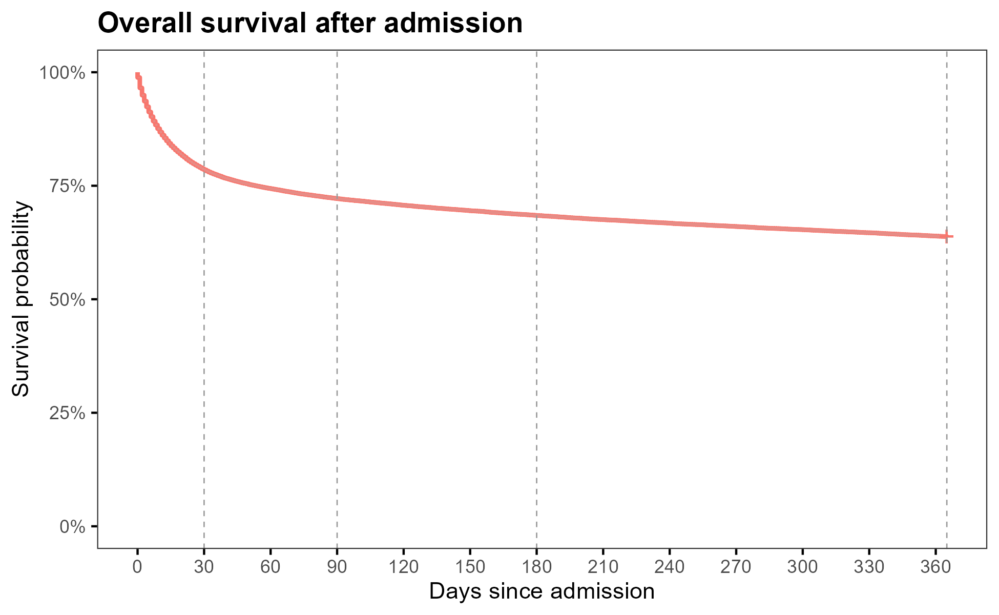
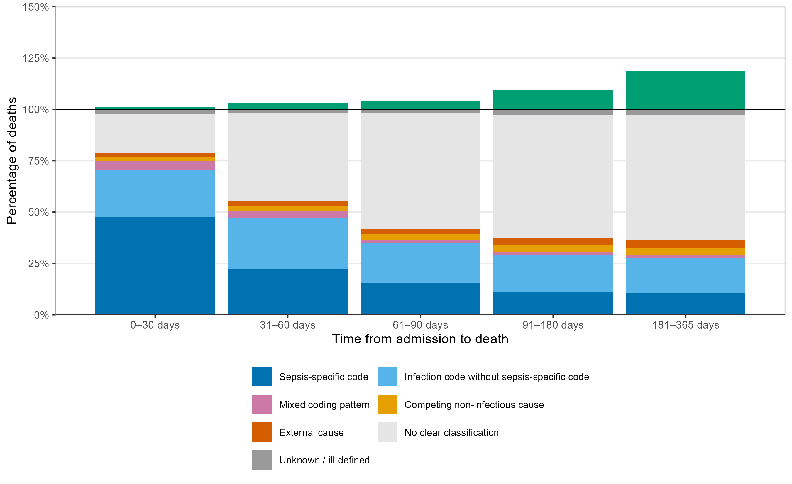

```{r}
#| label: packages
#| include: false
packages <- c("knitr", "rmarkdown", "dplyr", "tidyr", "tibble",
              "ggplot2", "patchwork", "survminer", "stringr", "flextable")
missing <- packages[!vapply(packages, requireNamespace, logical(1), quietly = TRUE)]
if (length(missing)) install.packages(missing, repos = "https://cloud.r-project.org")
library(dplyr)
library(tidyr)
library(flextable)

```

```{r}
#| label: read-results
#| include: false
# Same project and saved analysis as the main report.
root            <- "C:/dev/gitRepos/sepsis_mortality3"
paper_objects   <- readRDS(file.path(root, "05_Ergebnisse", "paper_objects_sepsis_analysis_2026-11-17.rds"))
numbers         <- paper_objects$paper_numbers
fmt_n           <- function(x) formatC(x, format = "f", digits = 0, big.mark = ",")
fmt_d           <- function(x, digits = 1) formatC(x, format = "f", digits = digits)

hospital        <- paper_objects$result_bundles[["09_hospital_comparisons"]]
mortality       <- paper_objects$result_bundles[["04_mortality_outcomes"]]
models          <- paper_objects$result_bundles[["08_models"]]
km              <- paper_objects$result_bundles[["06_descriptive_mortality"]]$plots
cod             <- paper_objects$result_bundles[["07_cod_analysis"]]

# Same paths for interactive chunks and rendering.
qmd_dir         <- file.path(root, "06_Quarto")
figure_dir      <- file.path(qmd_dir, "manuscript_assets", "generated", "supplement")
dir.create(figure_dir, recursive = TRUE, showWarnings = FALSE)

count_percent    <- function(n, total) paste0(fmt_n(n), " (", fmt_d(100 * n / total), "%)")
endpoint_changes <- hospital$summary_reclassification_models
poisson_changes  <- hospital$summary_reclassification_poisson
risk_raw         <- filter(hospital$summary_risk_adjustment_90d, comparison == "Raw vs Full model")
risk_age         <- filter(hospital$summary_risk_adjustment_90d, comparison == "Age and sex vs Full model")
limit_changes    <- hospital$summary_control_limits_90d
model_labels     <- c("Raw" = "Unadjusted", "Age and sex" = "Age- and sex-adjusted",
                      "Full model" = "Fully adjusted",
                      "Full model + interaction" = "Full model + age-group-by-comorbidity interaction")

```

```{r}
#| label: table-formatting
#| include: false
# One place to adjust the appearance of all supplement tables.
style_table <- function(data, widths, font_size = 10) {
  flextable(data) |>
    font(fontname = "Times New Roman", part = "all") |>
    fontsize(size = font_size, part = "all") |>
    bold(bold = TRUE, part = "header") |>
    line_spacing(space = 1, part = "all") |>
    padding(padding.top = 4, padding.bottom = 4,
            padding.left = 4, padding.right = 4, part = "all") |>
    bg(bg = "#E8E8E8", part = "header") |>
    valign(valign = "top", part = "all") |>
    border_remove() |>
    border_inner(border = officer::fp_border(color = "#ADADAD", width = 0.5)) |>
    hline_bottom(border = officer::fp_border(color = "#ADADAD", width = 0.5), part = "body") |>    
    width(width = widths) |>
    set_table_properties(layout = "fixed", align = "left",
                         opts_word = list(split = TRUE, repeat_headers = TRUE))
}

```


::: {custom-style="Title 1"}
In-hospital and 90-Day Post-Admission Mortality Yield Different Hospital Classifications After Sepsis: A Nationwide Swiss Cohort Study
:::

::: {custom-style="Title 2"}
Supplementary Material
:::

This supplementary material provides additional methodological details, variable definitions, descriptive results and sensitivity analyses supporting the main manuscript. It includes sepsis case definitions, mortality outcome and risk-adjustment specifications, hospital comparison methods, patient characteristics, survival curves and cause-of-death coding analyses. The STROBE–RECORD reporting checklist is provided in Section L.

# Contents

- A. Sepsis case definitions: Tables A1–A2 
- B. Outcome anand risk-adjustment variables: Tables B1–B2 
- C. Hospital-site identification and comparison methods: Table C1 
- D. Patient and hospitalisation characteristics: Table D1 
- E. Kaplan–Meier survival analyses: Figures E1–E2 
- F. Cause-of-death coding classification: Table F1; Figure F1 
- G. Risk-adjustment model performance: Table G1 
- H. Hospital characteristics by direction of endpoint-related reclassification: Table H1 
- I. Sensitivity of endpoint-related reclassification: Tables I1–I2 
- J. Sensitivity of 90-day mortality classification to risk adjustment: Table J1 
- K. Sensitivity of 90-day mortality classification to control-limit method: Table K1 
- L. STROBE–RECORD reporting checklist: Table L1



# Supplementary Section A. Sepsis case definitions

Sepsis hospitalisations were identified by searching all diagnosis fields for the ICD-10-GM codes listed in Supplementary Table A1, following the explicit administrative definition used in the Swiss Sepsis Report (Swiss Sepsis Program 2025). The code set included sepsis-specific codes and additional codes for systemic inflammatory response syndrome, septic shock, toxic shock syndrome and bacteraemia.

::: {custom-style="Beschriftung1"}
**Supplementary Table A1.** ICD-10-GM codes used for cohort identification according to the explicit administrative sepsis definition in the Swiss Sepsis Report.
:::

```{r}
#| label: table-a1
table_table_a1 <- tibble::tribble(
  ~V1, ~V2,
  "Sepsis-specific codes", "A02.1, A20.7, A32.7, A39.1, A39.2, A39.4, A40.0, A40.1, A40.2, A40.3, A40.8, A40.9, A41.0, A41.1, A41.2, A41.3, A41.4, A41.51, A41.52, A41.58, A41.8, A41.9, A42.7, B37.7, P36.0, P36.1, P36.2, P36.3, P36.4, P36.5, P36.8, P36.9, O85, O75.3",
  "Systemic inflammatory response syndrome (SIRS)", "R65.0, R65.1",
  "Septic shock", "R57.2",
  "Toxic shock syndrome", "A48.3",
  "Bacteraemia", "A49.9"
)
names(table_table_a1) <- c("Code group", "ICD-10-GM codes")
style_table(table_table_a1, widths = c(1.8, 4.7))
```

Supplementary Table A2 lists the infection and acute organ-dysfunction codes used in the implicit sepsis definition of the Swiss Sepsis Report (Swiss Sepsis Program 2025). This definition requires the combination of infection and acute organ dysfunction and was not used for cohort identification in this study. The infection component informed the code set used for the cause-of-death analysis, with additional infection codes specified in Supplementary Section F, Table F1. Organ-dysfunction codes were not used for that classification.

::: {custom-style="Beschriftung1"}
**Supplementary Table A2.** Infection and acute organ-dysfunction codes underlying the implicit sepsis definition in the Swiss Sepsis Report.
:::

```{r}
#| label: table-a2
table_table_a2 <- tibble::tribble(
  ~V1, ~V2,
  "Pathogen-specific bacterial, viral and fungal infections", "A01.0, A02.1, A32.7, A39.0, A39.1, A39.2, A39.3, A39.4, A39.5, A39.8, A39.9, A40.0, A40.1, A40.2, A40.3, A40.8, A40.9, A41.0, A41.1, A41.2, A41.3, A41.4, A41.5, A41.51, A41.52, A41.58, A41.8, A41.9, A42.7, A49.0, A49.1, A49.2, A49.3, A49.8, A49.9, B37.0, B37.1, B37.2, B37.3, B37.4, B37.5, B37.6, B37.7, B37.8, B37.9, B95.0, B95.1, B95.2, B95.3, B95.41, B95.42, B95.48, B95.5, B95.6, B95.7, B95.90, B95.91, B96.2, B96.3, B96.5, B96.6, B96.7, B96.8, P36.0, P36.1, P36.2, P36.3, P36.4, P36.5, P36.8, P36.9, P37.5, O85, O75.3, U07.1, U07.2",
  "Infection codes in other groups", "G00, G01, G02, G03, I30, I32, I33, I39, I40, I41, I80, J06, J09, J10, J11, J12, J13, J14, J15, J16, J17, J18, J20, J21, J22, J47, J85, J86, K35, K61, K65, L03, L04, L08, L88, M00, M01, M86, N10, N11, N12, N16, N30, N34",
  "Implicit organ dysfunction", "I95.8, R03.1, R57.0, R57.9, P29.0, J80, J96.00, J96.01, J96.09, J96.90, J96.91, J96.99, P28.5, G93.1, G93.4, F05.0, F05.1, F05.8, F05.9, P91.4, P91.5, P91.6, P91.9, R40.0, R40.1, R40.2, R41.0, N17.0, N17.1, N17.2, N17.8, N17.9, N19, P96.0, R34, K72.0, K72.71, K72.72, K72.73, K72.74, K72.79, K72.9, K76.9, D61.8, D61.9, D69.5, D69.6, P60, P61.0"
)
names(table_table_a2) <- c("Code group", "ICD-10-GM codes")
style_table(table_table_a2, widths = c(1.8, 4.7))

```



# Supplementary Section B. Outcome and risk-adjustment variables

Two binary mortality outcomes were used in the regression models and hospital-level comparisons (Table B1). In-hospital mortality (variable *death_in_hospital*) was defined by a discharge disposition of “deceased” in GVS (*discharge_decision* = 5). Additional deaths were identified from a non-missing discharge-to-death interval supplied through linkage of GVS and BEVNAT records. The 90-day post-admission mortality outcome (*death_90d_postadmission*) included deaths from either source occurring within 90 days of index admission, applying the interval rules described below.


::: {custom-style="Beschriftung1"}
**Supplementary Table B1.** Operational definitions of binary mortality outcomes.
:::

```{r}
#| label: table-b1
style_table(mortality$outcome_definitions, widths = c(1.7, 4.8))
```

::: {custom-style="Paper Paragraph after table"}
Deaths recorded as in-hospital deaths in GVS were retained regardless of the recorded discharge-to-death interval. For deaths identified through linkage but not recorded as in-hospital deaths, intervals of −1 day or longer were accepted; intervals below −1 day were excluded as implausible and were not counted as death events. This affected `r fmt_n(numbers$deaths_bevnat_only_excluded)` records, with intervals of −978 and −4,034 days, implying death approximately 2.7 and 11.0 years before discharge, respectively.
:::

For time-to-death calculations, the discharge-to-death interval was set to zero for deaths recorded as in-hospital deaths and for deaths identified through linkage with an accepted negative interval (−1 day). Time from admission to death was calculated as the length of the index hospitalisation (*episode_length*) plus this adjusted interval. Unlike length of stay, episode length includes time spent outside hospital during temporary discharges. A death contributed to the 90-day post-admission outcome only if the calculated time from admission to death was 90 days or less.

In addition, descriptive mortality was summarised at 30, 60, 90, 180 and 365 days from admission and discharge. Admission-based Kaplan–Meier analyses are described separately in Supplementary Section E.

Definitions of the variables used in the risk-adjustment models are summarised in Supplementary Table B2. All variables were derived from records of the index hospitalisation. The sepsis severity variable was a study-specific diagnosis-based proxy and not a validated clinical severity score or a reconstruction of the Sequential Organ Failure Assessment (SOFA) score. Descriptive Kaplan–Meier analyses showed distinct mortality patterns across the diagnosis-based severity categories, suggesting prognostic information within this cohort. However, SIRS and “severe sepsis” are not defining categories in the Sepsis-3 framework, and their coding may vary across hospitals. These survival differences alone do not establish the proxy’s suitability for risk adjustment in hospital benchmarking.

Adjustment sought to account for measured differences in patient case mix. However, comorbidity and severity measures derived from discharge diagnoses may also reflect conditions arising during hospitalisation and differences in coding practices or documentation completeness, rather than solely baseline risk. Intensive care admission and mechanical ventilation were described but excluded from adjustment because adjusting for care delivered after admission could obscure differences associated with care. The interaction model added an age-group-by-Elixhauser-score interaction to assess whether greater complexity improved predictive performance or changed hospital-level estimates.

::: {custom-style="Beschriftung1"}
**Supplementary Table B2.** Operational definitions of variables included in the risk-adjustment models.
:::

```{r}
#| label: table-b2
table_table_b2 <- tibble::tribble(
  ~V1, ~V2, ~V3,
  "Age group", "GVS", "Age categories provided or derived from the hospital discharge data: 0–27 days; 28–364 days; 1–4 years; 5–14 years; 15–39 years; 40–64 years; and ≥65 years.",
  "Sex", "GVS", "Recorded sex, categorised as male or female.",
  "Elixhauser van Walraven score", "GVS diagnosis fields", "Comorbidities were identified from secondary diagnosis fields only using the Quan ICD-10 Elixhauser algorithm implemented in the comorbidity R package. Elixhauser conditions were combined using van Walraven weights. Encounters without identified secondary Elixhauser comorbidities were assigned a score of 0. The continuous score was used in the regression models.",
  "Admission type", "GVS", "Categorised as emergency admission, planned admission, or other/unknown according to the recorded admission type.",
  "Position of sepsis-defining diagnosis", "GVS diagnosis fields", "Categorised as principal diagnosis if a qualifying sepsis code was recorded in the principal diagnosis field, irrespective of additional qualifying codes elsewhere. Otherwise, qualifying codes in secondary diagnosis fields or as an add-on to the principal diagnosis were grouped together.",
  "Diagnosis-based sepsis severity proxy", "GVS diagnosis fields", "Assigned hierarchically from the recorded sepsis-trigger codes: septic shock (R57.2), followed by severe sepsis/SIRS with organ dysfunction (R65.1), SIRS without organ dysfunction (R65.0), and other explicit sepsis codes. The first applicable category was used."
)
names(table_table_b2) <- c("Variable", "Source", "Operationalisation")
style_table(table_table_b2, widths = c(1, 1, 4.5))
```



# Supplementary Section C. Hospital-site identification and comparison methods

Anonymised hospital and local hospital-unit identifiers were used to construct a longitudinal hospital-site identifier across study years. Because hospital identities were not disclosed, site assignments could be assessed only through internal consistency checks comparing hospital–site mappings across years. 


Expected deaths were calculated by summing individual predicted probabilities from the corresponding mortality model. Observed-to-expected ratios were calculated as observed divided by expected deaths; indirectly standardised mortality rates were obtained by multiplying these ratios by the overall cohort mortality.


Hospital-level analyses were restricted to hospital sites with at least `r fmt_n(hospital$selected_threshold_summary$threshold)` eligible index sepsis hospitalisations pooled across 2021–2024. This analytical threshold was selected to reduce instability in estimates from very small hospital sites while retaining most of the study population. At this threshold, `r fmt_n(numbers$hospital_sites)` hospital sites and `r fmt_n(numbers$hospital_cases)` of `r fmt_n(numbers$cohort_size)` index hospitalisations (`r fmt_d(hospital$selected_threshold_summary$pct_sepsis_cases)`%) were retained. Supplementary Table C1 shows how alternative minimum-volume thresholds affected the numbers of hospital sites and index hospitalisations retained.

::: {custom-style="Beschriftung1"}
**Supplementary Table C1.** Hospital sites and index sepsis hospitalisations retained under alternative pooled minimum-volume thresholds, 2021–2024. Percentages are relative to all `r fmt_n(nrow(hospital$hospital_site_volume_pooled))` hospital sites and `r fmt_n(numbers$cohort_size)` eligible index sepsis hospitalisations before application of a minimum-volume threshold
:::

```{r}
#| label: table-c1
table_c1 <- hospital$hospital_thresholds_table |>
  transmute(`Minimum pooled case volume` = fmt_n(threshold),
            `Hospital sites retained` = fmt_n(hospital_sites),
            `Hospital sites retained (%)` = paste0(fmt_d(pct_hospital_sites), "%"),
            `Index hospitalisations retained` = fmt_n(sepsis_cases),
            `Index hospitalisations retained (%)` = paste0(fmt_d(pct_sepsis_cases), "%"))

style_table(table_c1, widths = c(1.2, 1.1, 1.2, 1.5, 1.5)) |> 
  align(j = 2:ncol(table_c1), align = "right", part = "all") 

```



# Supplementary Section D. Patient and hospitalisation characteristics

Supplementary Table D1 summarises patient and hospitalisation characteristics for all `r fmt_n(numbers$cohort_size)` eligible index hospitalisations, before application of the hospital-site minimum-volume threshold. Neither mortality outcome had missing values. After variable derivation and categorisation, there were no missing values in the covariates used in the risk-adjustment models.

::: {custom-style="Beschriftung1"}
**Supplementary Table D1.** Patient and hospitalisation characteristics of the study cohort (`r fmt_n(numbers$cohort_size)` index hospitalisations). Percentages are based on all `r fmt_n(numbers$cohort_size)` index hospitalisations and may not sum to 100% because of rounding. The Elixhauser van Walraven score is grouped for descriptive presentation but was entered as a continuous variable in the risk-adjustment models. SIRS, systemic inflammatory response syndrome; ICU, intensive care unit.
:::

```{r}
#| label: table-d1
characteristic_order <- c("Age group", "Sex", "Admission type", "Position of sepsis-defining diagnosis",
                          "Diagnosis-based sepsis severity proxy", "Elixhauser van Walraven score",
                          "ICU admission", "Mechanical ventilation")
table_d1 <- numbers$cohort_characteristics |>
  mutate(characteristic = recode(characteristic,
    "Sepsis trigger position" = "Position of sepsis-defining diagnosis",
    "Sepsis severity" = "Diagnosis-based sepsis severity proxy",
    "Elixhauser group" = "Elixhauser van Walraven score")) |>
  arrange(match(characteristic, characteristic_order),
          match(category, c("0–27 days", "28–364 days", "1–4 years", "5–14 years",
                            "15–39 years", "40–64 years", "≥65 years", "Female", "Male",
                            "Emergency admission", "Other / unknown", "Planned admission",
                            "Principal diagnosis", "Secondary diagnosis or add-on to the principal diagnosis",
                            "Other explicit sepsis code", "SIRS without organ dysfunction",
                            "Severe sepsis / SIRS with organ dysfunction", "Septic shock",
                            "≤0", "1–5", "6–10", "11–20", ">20",
                            "ICU admission", "No ICU admission",
                            "Mechanical ventilation", "No mechanical ventilation"))) |>
  transmute(Characteristic = characteristic, Category = category,
            n = fmt_n(n), `%` = paste0(fmt_d(pct), "%"))
style_table(table_d1, widths = c(1.6, 3.4, 0.75, 0.75)) |>
  align(j = 3:ncol(table_d1), align = "right", part = "all") |> 
  merge_v(j = "Characteristic")
```



# Supplementary Section E. Kaplan–Meier survival analyses

Kaplan–Meier curves describe unadjusted survival from admission for the index sepsis hospitalisation, overall and by age, sex, comorbidity burden, admission type, position of the sepsis-defining diagnosis, and the diagnosis-based sepsis severity proxy. These analyses were descriptive and were intended to illustrate heterogeneity in survival rather than estimate adjusted associations. Additional curves stratified by ICU admission, ICU length of stay, and mechanical ventilation describe groups defined by care received during the index hospitalisation; these variables were not included in the risk-adjustment models.

::: {custom-style="Beschriftung1"}
**Supplementary Figure E1.** Overall Kaplan–Meier survival from admission for the index sepsis hospitalisation, 2021–2024. The first 365 days after admission are shown. Follow-up was administratively censored on 31 December 2025.
:::

```{r}
#| label: figure-e1
#| include: false
figure_e1 <- km$overall_postadmission
ggplot2::ggsave(file.path(figure_dir, "figure-e1.png"), figure_e1,
                width = 6.5, height = 4, dpi = 300, bg = "white")
```

{width="6.5in" fig-cap="false"}



::: {custom-style="Beschriftung1"}
**Supplementary Figure E2.** Kaplan–Meier survival from admission for the index sepsis hospitalisation by patient and hospitalisation characteristics, 2021–2024. Follow-up was censored at 365 days after admission. Curves are unadjusted. ICU admission, ICU length of stay, and mechanical ventilation describe care received during the index hospitalisation. ICU, intensive care unit; SIRS, systemic inflammatory response syndrome.
:::

```{r}
#| label: figure-e2
#| include: false

okabe_ito <- c(
  orange         = "#E69F00",
  sky_blue       = "#56B4E9",
  bluish_green   = "#009E73",
  yellow         = "#F0E442",
  blue           = "#0072B2",
  vermillion     = "#D55E00",
  reddish_purple = "#CC79A7",
  black          = "#000000",
  grey           = "#999999"
)

# Start with the blue and purple used in the paper.
km_colours <- unname(okabe_ito[c(
  "blue", "reddish_purple", "bluish_green",
  "orange", "sky_blue", "vermillion", "yellow"
)])

# Panel order matches the reference figure.
km_names <- c(
  "age_group", "sex", "sepsis_severity",
  "admission_type", "trigger_position", "elixhauser",
  "icu_admission", "icu_length_of_stay", "mechanical_ventilation"
)

km_titles <- c(
  "Age group", "Sex", "Sepsis severity proxy",
  "Admission type", "Diagnosis trigger position",
  "Elixhauser van Walraven score",
  "ICU admission", "ICU length of stay", "Mechanical ventilation"
)

missing_plots <- setdiff(km_names, names(km))

if (length(missing_plots)) {
  stop(
    "Add these plots to the saved mortality bundle and rebuild paper_objects: ",
    paste(missing_plots, collapse = ", ")
  )
}

# Remove the internal variable prefix and wrap long legend labels.
km_labels <- function(x) {
  x <- sub("^km_group=", "", x)
  stringr::str_wrap(x, width = 30)
}

km_panels <- lapply(seq_along(km_names), function(i) {

  p <- km[[km_names[i]]]

  # Replace the existing reference lines to include day 60.
  is_vline <- vapply(
    p$layers,
    function(layer) inherits(layer$geom, "GeomVline"),
    logical(1)
  )

  p$layers <- p$layers[!is_vline]

  p +
    ggplot2::geom_vline(
      xintercept = c(30, 60, 90, 180, 365),
      linetype = "dashed",
      linewidth = 0.3,
      colour = "grey60"
    ) +
    ggplot2::scale_colour_manual(
      values = km_colours,
      name = NULL,
      labels = km_labels
    ) +
    ggplot2::scale_fill_manual(
      values = km_colours,
      name = NULL,
      labels = km_labels
    ) +
    ggplot2::labs(
      title = km_titles[i],
      x = "Days since hospital admission",
      y = "Survival probability"
    ) +
    ggplot2::guides(
      colour = ggplot2::guide_legend(ncol = 2, byrow = TRUE),
      fill = ggplot2::guide_legend(ncol = 2, byrow = TRUE)
    ) +
    ggplot2::theme(
      panel.grid = ggplot2::element_blank(),

      plot.title = ggplot2::element_text(
        size = 11,
        face = "bold",
        hjust = 0
      ),

      axis.title = ggplot2::element_text(size = 8),
      axis.text = ggplot2::element_text(size = 7),

      legend.position = "bottom",
      legend.title = ggplot2::element_blank(),
      legend.text = ggplot2::element_text(size = 7),
      legend.key.width = grid::unit(0.35, "cm"),
      legend.key.height = grid::unit(0.3, "cm"),
      legend.spacing.x = grid::unit(0.1, "cm"),
      legend.margin = ggplot2::margin(0, 0, 0, 0),

      plot.margin = ggplot2::margin(5, 7, 5, 5)
    )
})

figure_e2 <- patchwork::wrap_plots(
  km_panels,
  ncol = 3,
  nrow = 3,
  guides = "keep"
)

ggplot2::ggsave(
  filename = file.path(figure_dir, "figure-e2.png"),
  plot = figure_e2,
  width = 12,
  height = 13,
  units = "in",
  dpi = 300,
  bg = "white"
)

# Interactive preview.
print(figure_e2)
```

{width="6.5in"}




# Supplementary Section F. Cause-of-death coding classification


Data from the Swiss Federal Statistical Office’s (FSO) Cause of Death Statistics (CoD) were used to explore the potential attribution of deaths to sepsis across intervals following index admission. This descriptive assessment relied on recorded causes of death rather than individual causal adjudication.

Codes were searched across all available cause-of-death variables. Deaths with an available CoD record were assigned to mutually exclusive categories using the hierarchy in Supplementary Table F1; the first applicable category was assigned. Deaths without an available CoD record were identified separately.

CoD data were available through 2024, whereas mortality follow-up extended through 31 December 2025, limiting interpretation at longer follow-up intervals.

::: {custom-style="Beschriftung1"}
**Supplementary Table F1.** Categories, code groups and hierarchy used to classify cause-of-death records. The first applicable category was assigned. Codes from Supplementary Table A1 were matched exactly after removal of decimal points. Infection, external-cause and competing non-infectious cause codes were matched by prefix, including subcategories.
:::

```{r}
#| label: table-f1

table_table_f1 <- tibble::tribble(
  ~Category, ~`Classification rule and code groups`, ~Hierarchy,
  "Sepsis-specific code",
  "Any code included in the explicit administrative sepsis definition (Supplementary Table A1).",
  "2",
  "Infection code without sepsis-specific code",
  "Infection codes in Supplementary Table A2, plus J69, N39.0, T81.4, T82.6, T82.7, T84.5, T84.6, T84.7, T85.7 and O86, without a code from the explicit sepsis definition. Organ-dysfunction codes are excluded.",
  "3",
  "Mixed coding pattern",
  "A code from the explicit sepsis definition or an infection code, together with an external-cause or competing non-infectious cause code.",
  "1",
  "Competing non-infectious cause",
  "I21, I71, T79, I60, I61 or I62 codes.",
  "6",
  "External cause",
  "V, W or X codes.",
  "5",
  "No clear classification",
  "All remaining coding patterns.",
  "7",
  "Unknown / ill-defined",
  "All five cause-of-death variables missing, blank or coded R99.",
  "4"
)
style_table(table_table_f1, widths = c(1.8, 3.8, 0.9))

```


::: {custom-style="Paper Paragraph after table"}
Among deaths with an available CoD record, codes from the explicit sepsis definition became less frequent with increasing time from admission. Infection codes remained present throughout the first year, while the proportions with no clear classification or without an available CoD record increased. These patterns provided limited guidance for selecting an optimal mortality follow-up window.
:::

::: {custom-style="Beschriftung1"}
**Supplementary Figure F1.** Cause-of-death coding patterns by time from index sepsis admission. Deaths within 365 days were classified using Supplementary Table F1. Coloured segments show category distributions among deaths with an available Cause of Death Statistics (CoD) record and sum to 100% within each interval. Green bars above 100% separately show the percentage of all deaths in each interval without an available CoD record. Sources: Swiss Federal Statistical Office — Health Services Statistics (GVS), Cause of Death Statistics (CoD), and Vital Statistics (BEVNAT).
:::

```{r}
#| label: figure-f1
#| include: false

# Extract colours as plain strings, whether the palette is a list or vector.
palette_colour <- function(name) unname(okabe_ito[[name]])

cod_colours <- c(
  "Sepsis-specific code" =
    palette_colour("blue"),
  "Infection code without sepsis-specific code" =
    palette_colour("sky_blue"),
  "Mixed coding pattern" =
    palette_colour("reddish_purple"),
  "Competing non-infectious cause" =
    palette_colour("orange"),
  "External cause" =
    palette_colour("vermillion"),
  "No clear classification" =
    "#E5E5E5",
  "Unknown / ill-defined" =
    palette_colour("grey")
)

figure_f1 <- cod$p_cod_evidence +
  ggplot2::scale_fill_manual(
    values = cod_colours,
    breaks = names(cod_colours),
    drop = FALSE
  ) +
  ggplot2::labs(caption = NULL, fill = NULL) +
  ggplot2::guides(
    fill = ggplot2::guide_legend(ncol = 2, byrow = TRUE)
  ) +
  ggplot2::theme(
    legend.position = "bottom",
    legend.text = ggplot2::element_text(size = 8)
  )

# The second layer draws the bars above 100%.
figure_f1$layers[[2]]$aes_params$fill <-
  unname(okabe_ito[["bluish_green"]])

ggplot2::ggsave(
  filename = file.path(figure_dir, "figure-f1.png"),
  plot = figure_f1,
  width = 9,
  height = 5.5,
  dpi = 300,
  bg = "white"
)

print(figure_f1)

```

{width="6.5in" fig-cap="false"}



# Supplementary Section G. Risk-adjustment model performance

Model fit and predictive performance were assessed using the Akaike information criterion (AIC), Brier score, Tjur’s R² and McFadden’s pseudo-R². All measures were calculated in the data used to fit the models. Results for alternative risk-adjustment specifications are presented separately for each mortality endpoint in Supplementary Table G1.

::: {custom-style="Beschriftung1"}
**Supplementary Table G1.** Model fit and predictive performance of alternative risk-adjustment models for in-hospital and 90-day post-admission mortality. The fully adjusted model included age group, sex, the continuous Elixhauser van Walraven score, admission type, position of the sepsis-defining diagnosis and the diagnosis-based sepsis severity proxy. The interaction model additionally included an interaction between age group and the Elixhauser van Walraven score. The number of parameters (df) includes the intercept. Lower AIC and Brier scores and higher Tjur’s R² and McFadden’s pseudo-R² indicate better performance when comparing models for the same mortality endpoint.
:::

```{r}
#| label: table-g1
table_g1 <- models$model_performance_table |>
  transmute(Outcome = outcome, Model = unname(model_labels[as.character(model)]),
            df = fmt_n(df), AIC = fmt_d(aic),
            `Brier score` = fmt_d(brier_score, 3),
            `Tjur R²` = fmt_d(tjur_r2, 3),
            `McFadden pseudo-R²` = fmt_d(mcfadden_r2, 3))

style_table(table_g1, widths = c(1.25, 1.6, 0.35, 0.8, 0.8, 0.8, 0.9), font_size = 9) |>
  align(j = 3:ncol(table_g1), align = "right", part = "all")

```



# Supplementary Section H. Hospital characteristics by direction of endpoint-related reclassification

Hospital characteristics were compared descriptively across sites moving towards higher or lower mortality classifications and sites whose classification remained unchanged when switching from in-hospital to 90-day post-admission mortality. Comparisons are based on hospital classifications derived from fully adjusted models with overdispersion-adjusted 95% control limits.

::: {custom-style="Beschriftung1"}
**Supplementary Table H1.** Hospital characteristics by direction of reclassification from in-hospital to 90-day post-admission mortality. Values are medians (interquartile ranges) across hospital sites within each group. Length of stay was first summarised as the median within each hospital site. The proportion of deaths occurring after discharge was calculated among all deaths within 90 days of admission at each site. Transfer percentages were calculated among eligible index hospitalisations at each site. Higher and lower classifications refer to movement between the categories “lower than expected”, “within control limits” and “higher than expected”; they do not indicate established differences in care quality.
:::

```{r}
#| label: table-h1
# Present the saved group summaries as columns, as in the original supplement.
profile_order <- c("No change", "Toward higher mortality classification", "Toward lower mortality classification")
profiles <- hospital$hospital_profile_by_direction |>
  arrange(match(reclassification_direction, profile_order))
iqr <- function(m, lo, hi, digits = 1) {
  paste0(fmt_d(m, digits), " (", fmt_d(lo, digits), "–", fmt_d(hi, digits), ")")
}
table_h1 <- data.frame(Characteristic = c(
  "Eligible index sepsis hospitalisations, n",
  "Site-level median length of stay, days",
  "90-day deaths occurring after index discharge, %",
  "Transfer to another acute-care hospital or acute-care unit, %"))
for (i in seq_len(nrow(profiles))) {
  p <- profiles[i, ]
  header <- paste0(p$reclassification_direction, " (n = ", fmt_n(p$n_hospitals), ")")
  table_h1[[header]] <- c(
    iqr(p$median_cases, p$q1_cases, p$q3_cases, 0),
    iqr(p$median_los, p$q1_los, p$q3_los),
    iqr(p$median_postdischarge_share, p$q1_postdischarge_share, p$q3_postdischarge_share),
    iqr(p$median_acute_transfer, p$q1_acute_transfer, p$q3_acute_transfer))
}

style_table(table_h1, widths = c(2.3, 1.4, 1.4, 1.4)) |> 
  align(j = 2:ncol(table_h1), align = "center", part = "all")

```



# Supplementary Section I. Sensitivity of endpoint-related reclassification

Hospital classifications based on in-hospital and 90-day post-admission mortality were compared under unadjusted, age- and sex-adjusted, and fully adjusted models, using overdispersion-adjusted 95% control limits. Reclassification between endpoints occurred under all three specifications, affecting `r fmt_d(min(endpoint_changes$pct_reclassified))`%–`r fmt_d(max(endpoint_changes$pct_reclassified))`% of hospital sites (Supplementary Table I1). The endpoint comparison was repeated using conventional Poisson 95% control limits while retaining the fully adjusted model. Under these limits, `r fmt_n(poisson_changes$changed_category)` of `r fmt_n(poisson_changes$n_hospitals)` hospital sites (`r fmt_d(poisson_changes$pct_changed_category)`%) changed classification between endpoints, compared with `r fmt_n(numbers$sites_reclassified_endpoints)` (`r fmt_d(numbers$pct_sites_reclassified_endpoints)`%) under overdispersion-adjusted limits (Supplementary Table I2).

::: {custom-style="Beschriftung1"}
**Supplementary Table I1.** Reclassification between in-hospital and 90-day post-admission mortality under alternative risk-adjustment specifications. Classifications were based on overdispersion-adjusted 95% control limits.
:::

```{r}
#| label: table-i1
table_i1 <- hospital$summary_reclassification_models |>
  transmute(Model = unname(model_labels[as.character(model)]),
            `Hospital sites` = fmt_n(n_hospitals),
            `Same classification, n (%)` = count_percent(same_category, n_hospitals),
            `Changed classification, n (%)` = count_percent(reclassified, n_hospitals))

style_table(table_i1, widths = c(1.7, 1, 1.9, 1.9)) |>   
  align(j = 2:ncol(table_i1), align = "right", part = "all")

```

::: {custom-style="Beschriftung1"}
**Supplementary Table I2.** Reclassification between in-hospital and 90-day post-admission mortality using conventional Poisson 95% control limits and the fully adjusted model.
:::

```{r}
#| label: table-i2
table_i2 <- hospital$summary_reclassification_poisson |>
  transmute(Model = "Fully adjusted", `Hospital sites` = fmt_n(n_hospitals),
            `Same classification, n (%)` = count_percent(same_category, n_hospitals),
            `Changed classification, n (%)` = count_percent(changed_category, n_hospitals))

style_table(table_i2, widths = c(1.7, 1, 1.9, 1.9))|>   
  align(j = 2:ncol(table_i2), align = "right", part = "all")

```



# Supplementary Section J. Sensitivity of 90-day mortality classification to risk adjustment

To examine the influence of risk adjustment while holding the mortality endpoint constant, hospital classifications for 90-day post-admission mortality were compared using overdispersion-adjusted 95% control limits. Classifications differed from those obtained with the fully adjusted model for `r fmt_n(risk_raw$n_changed)` of `r fmt_n(risk_raw$n_sites)` hospital sites (`r fmt_d(risk_raw$pct_changed)`%) under the unadjusted model and `r fmt_n(risk_age$n_changed)` (`r fmt_d(risk_age$pct_changed)`%) under the age- and sex-adjusted model (Supplementary Table J1).

::: {custom-style="Beschriftung1"}
**Supplementary Table J1.** Hospital classification for 90-day post-admission mortality under alternative risk-adjustment specifications. Comparisons use the fully adjusted model as the reference. All classifications were based on overdispersion-adjusted 95% control limits.
:::

```{r}
#| label: table-j1
table_j1 <- hospital$summary_risk_adjustment_90d |>
  transmute(Comparison = recode(comparison,
              "Raw vs Full model" = "Unadjusted vs fully adjusted",
              "Age and sex vs Full model" = "Age- and sex-adjusted vs fully adjusted"),
            `Hospital sites` = fmt_n(n_sites),
            `Same as reference, n (%)` = count_percent(n_same, n_sites),
            `Different from reference, n (%)` = count_percent(n_changed, n_sites))

style_table(table_j1, widths = c(2, 0.8, 1.85, 1.85))|>   
  align(j = 2:ncol(table_j1), align = "right", part = "all")
```



# Supplementary Section K. Sensitivity of 90-day mortality classification to control-limit method

To examine the influence of the control-limit method while holding the mortality endpoint and risk-adjustment model constant, classifications for 90-day post-admission mortality were compared using conventional Poisson and overdispersion-adjusted 95% control limits, with the fully adjusted model retained throughout. Classifications were identical for `r fmt_n(limit_changes$same_category)` of `r fmt_n(limit_changes$n_hospitals)` hospital sites under both methods (Supplementary Table K1).

::: {custom-style="Beschriftung1"}
**Supplementary Table K1.** Comparison of hospital classifications for 90-day post-admission mortality using conventional Poisson and overdispersion-adjusted 95% control limits. The fully adjusted model was used throughout.
:::

```{r}
#| label: table-k1
table_k1 <- hospital$summary_control_limits_90d |>
  transmute(Model = "Fully adjusted", `Hospital sites` = fmt_n(n_hospitals),
            `Same under both methods, n (%)` = count_percent(same_category, n_hospitals),
            `Different between methods, n (%)` = count_percent(changed_category, n_hospitals))

style_table(table_k1, widths = c(1.7, 1, 1.9, 1.9)) |> 
  align(j = 2:ncol(table_h1), align = "right", part = "all")

```



# Supplementary Section L. STROBE–RECORD reporting checklist

::: {custom-style="Beschriftung1"}
**Supplementary Table L1.** STROBE–RECORD reporting checklist for this cohort study. Locations refer to the main manuscript unless supplementary material or end matter is specified. STROBE items reproduce the cohort-study wording; instructions specific to case-control and cross-sectional studies are omitted.
:::

```{r}
#| label: table-l1

table_l1 <- tibble::tribble(
  ~`Item No.`, ~Item, ~Checklist, ~`Location in manuscript`,

  "1",
  "(a) Indicate the study’s design with a commonly used term in the title or the abstract.\n\n(b) Provide in the abstract an informative and balanced summary of what was done and what was found.",
  "STROBE",
  "(a) Title; Abstract: Methods.\n\n(b) Abstract.",

  "1.1",
  "The type of data used should be specified in the title or abstract. When possible, the name of the databases used should be included.",
  "RECORD",
  "Abstract: Methods. Database names are provided in Methods: Study design and data sources.",

  "1.2",
  "If applicable, the geographic region and timeframe within which the study took place should be reported in the title or abstract.",
  "RECORD",
  "Title; Abstract: Methods.",

  "1.3",
  "If linkage between databases was conducted for the study, this should be clearly stated in the title or abstract.",
  "RECORD",
  "Abstract: Methods.",

  "2",
  "Explain the scientific background and rationale for the investigation being reported.",
  "STROBE",
  "Introduction.",

  "3",
  "State specific objectives, including any prespecified hypotheses.",
  "STROBE",
  "Introduction: final paragraph.",

  "4",
  "Present key elements of study design early in the paper.",
  "STROBE",
  "Methods: Study design and data sources.",

  "5",
  "Describe the setting, locations, and relevant dates, including periods of recruitment, exposure, follow-up, and data collection.",
  "STROBE",
  "Methods: Study design and data sources; Study population and index hospitalisation; Mortality outcomes.",

  "6",
  "(a) Give the eligibility criteria, and the sources and methods of selection of participants. Describe methods of follow-up.\n\n(b) For matched studies, give matching criteria and number of exposed and unexposed.",
  "STROBE",
  "(a) Methods: Study population and index hospitalisation; Mortality outcomes; Figure 1.\n\n(b) Not applicable: unmatched cohort.",

  "6.1",
  "The methods of study population selection (such as codes or algorithms used to identify subjects) should be listed in detail. If this is not possible, an explanation should be provided.",
  "RECORD",
  "Methods: Study population and index hospitalisation; Supplementary Section A and Table A1; Figure 1.",

  "6.2",
  "Any validation studies of the codes or algorithms used to select the population should be referenced. If validation was conducted for this study and not published elsewhere, detailed methods and results should be provided.",
  "RECORD",
  "Methods: Study population and index hospitalisation. Previous Swiss research is cited; absence of independent clinical validation is stated.",

  "6.3",
  "If the study involved linkage of databases, consider use of a flow diagram or other graphical display to demonstrate the data linkage process, including the number of individuals with linked data at each stage.",
  "RECORD",
  "Figure 1 documents cohort selection, including exclusion of records without valid patient identifiers. A linkage-specific diagram and linkage-stage counts are not provided.",

  "7",
  "Clearly define all outcomes, exposures, predictors, potential confounders, and effect modifiers. Give diagnostic criteria, if applicable.",
  "STROBE",
  "Methods: Study population and index hospitalisation; Mortality outcomes; Statistical analysis; Supplementary Sections A–B and F.",

  "7.1",
  "A complete list of codes and algorithms used to classify exposures, outcomes, confounders, and effect modifiers should be provided. If these cannot be reported, an explanation should be provided.",
  "RECORD",
  "Supplementary Tables A1–A2, B1–B2 and F1. Table B2 identifies the comorbidity algorithm, software implementation and weighting method; code availability is not stated.",

  "8",
  "For each variable of interest, give sources of data and details of methods of assessment (measurement). Describe comparability of assessment methods if there is more than one group.",
  "STROBE",
  "Methods: Study design and data sources; Mortality outcomes; Statistical analysis; Supplementary Sections A–C and F.",

  "9",
  "Describe any efforts to address potential sources of bias.",
  "STROBE",
  "Methods: Study population and index hospitalisation; Mortality outcomes; Statistical analysis; Supplementary Sections B–C.",

  "10",
  "Explain how the study size was arrived at.",
  "STROBE",
  "Methods: Study population and index hospitalisation.",

  "11",
  "Explain how quantitative variables were handled in the analyses. If applicable, describe which groupings were chosen, and why.",
  "STROBE",
  "Methods: Statistical analysis; Supplementary Tables B2 and D1. Rationale for the age-category boundaries is not explicit.",

  "12",
  "(a) Describe all statistical methods, including those used to control for confounding.\n\n(b) Describe any methods used to examine subgroups and interactions.\n\n(c) Explain how missing data were addressed.\n\n(d) If applicable, explain how loss to follow-up was addressed.\n\n(e) Describe any sensitivity analyses.",
  "STROBE",
  "(a) Methods: Statistical analysis; Supplementary Sections B–C.\n\n(b) Methods: Statistical analysis; Supplementary Sections B and E.\n\n(c) Supplementary Sections B and D; handling of missing source values needs clarification.\n\n(d) Methods: Mortality outcomes; Discussion: Strengths and limitations.\n\n(e) Methods: Statistical analysis; Supplementary Sections I–K.",

  "12.1",
  "Authors should describe the extent to which the investigators had access to the database population used to create the study population.",
  "RECORD",
  "End matter: Ethics and other permissions; Data Availability Statement. Scope of the source extract available to investigators needs clarification.",

  "12.2",
  "Authors should provide information on the data cleaning methods used in the study.",
  "RECORD",
  "Methods: Study population and index hospitalisation; Mortality outcomes; Supplementary Sections B–C.",

  "12.3",
  "State whether the study included person-level, institutional-level, or other data linkage across two or more databases. The methods of linkage and methods of linkage quality evaluation should be provided.",
  "RECORD",
  "Methods: Study design and data sources; Study population and index hospitalisation; End matter: Ethics and other permissions. Detailed linkage methods and linkage-quality evaluation are not reported.",

  "13",
  "(a) Report the numbers of individuals at each stage of the study (e.g., numbers potentially eligible, examined for eligibility, confirmed eligible, included in the study, completing follow-up, and analysed).\n\n(b) Give reasons for non-participation at each stage.\n\n(c) Consider use of a flow diagram.",
  "STROBE",
  "(a–c) Results: Study cohort and patient characteristics; Figure 1. Supplementary Table C1 reports inclusion under hospital-volume thresholds.",

  "13.1",
  "Describe in detail the selection of the persons included in the study (i.e., study population selection) including filtering based on data quality, data availability and linkage. The selection of included persons can be described in the text and/or by means of the study flow diagram.",
  "RECORD",
  "Methods: Study population and index hospitalisation; Results: Study cohort and patient characteristics; Figure 1; Supplementary Section B.",

  "14",
  "(a) Give characteristics of study participants (e.g., demographic, clinical, social) and information on exposures and potential confounders.\n\n(b) Indicate the number of participants with missing data for each variable of interest.\n\n(c) Summarise follow-up time (e.g., average and total amount).",
  "STROBE",
  "(a) Results: Study cohort and patient characteristics; Supplementary Table D1.\n\n(b) Supplementary Section D reports no missing outcomes or derived model covariates; missingness in source variables and other descriptive variables is not fully documented.\n\n(c) Follow-up windows are described in Methods: Mortality outcomes and Supplementary Section E; an observed follow-up summary is not reported.",

  "15",
  "Report numbers of outcome events or summary measures over time.",
  "STROBE",
  "Results: Mortality across follow-up windows; Table 1; Supplementary Figures E1–E2.",

  "16",
  "(a) Give unadjusted estimates and, if applicable, confounder-adjusted estimates and their precision (e.g., 95% confidence interval). Make clear which confounders were adjusted for and why they were included.\n\n(b) Report category boundaries when continuous variables were categorized.\n\n(c) If relevant, consider translating estimates of relative risk into absolute risk for a meaningful time period.",
  "STROBE",
  "(a) Methods: Statistical analysis; Results: Hospital mortality classifications; Figure 2; Supplementary Sections B–C and I–K. Funnel control limits are shown; individual hospital-estimate confidence intervals are not separately reported.\n\n(b) Supplementary Tables B2 and D1.\n\n(c) Table 1 reports absolute mortality proportions at defined follow-up windows.",

  "17",
  "Report other analyses done—e.g., analyses of subgroups and interactions, and sensitivity analyses.",
  "STROBE",
  "Results: Hospital mortality classifications; Sensitivity of endpoint-related reclassification; Sensitivity of classification at a fixed mortality endpoint; Figure 3; Supplementary Sections E–K.",

  "18",
  "Summarise key results with reference to study objectives.",
  "STROBE",
  "Discussion: Statement of principal findings.",

  "19",
  "Discuss limitations of the study, taking into account sources of potential bias or imprecision. Discuss both direction and magnitude of any potential bias.",
  "STROBE",
  "Discussion: Strengths and limitations; Interpretation within the context of the wider literature. Potential bias directions are discussed in part; magnitudes are not generally quantified.",

  "19.1",
  "Discuss the implications of using data that were not created or collected to answer the specific research question(s). Include discussion of misclassification bias, unmeasured confounding, missing data, and changing eligibility over time, as they pertain to the study being reported.",
  "RECORD",
  "Discussion: Strengths and limitations; Interpretation within the context of the wider literature; Supplementary Section B. Implications of missing source data and changing eligibility or ascertainment over time are not explicitly addressed.",

  "20",
  "Give a cautious overall interpretation of results considering objectives, limitations, multiplicity of analyses, results from similar studies, and other relevant evidence.",
  "STROBE",
  "Discussion: Interpretation within the context of the wider literature; Implications for policy, practice and research; Conclusions.",

  "21",
  "Discuss the generalisability (external validity) of the study results.",
  "STROBE",
  "Discussion: Strengths and limitations; Implications for policy, practice and research. Nationwide coverage and low-volume-site exclusions are discussed; generalisability outside Switzerland is not explicit.",

  "22",
  "Give the source of funding and the role of the funders for the present study and, if applicable, for the original study on which the present article is based.",
  "STROBE",
  "End matter: Funding. Funding and employment are described; the role of supporting institutions is not explicit.",

  "22.1",
  "Authors should provide information on how to access any supplemental information such as the study protocol, raw data, or programming code.",
  "RECORD",
  "Supplementary material; End matter: Data Availability Statement. Data-access arrangements are described; protocol and programming-code availability are not stated."
)

style_table(
  table_l1,
  widths = c(0.5, 2.7, 0.8, 2.5),
  font_size = 9
) |>
  flextable::align(
    j = c("Item No.", "Checklist"),
    align = "center",
    part = "all"
  ) |>
  flextable::align(
    j = c("Item", "Location in manuscript"),
    align = "left",
    part = "all"
  )
```

::: {custom-style="Beschriftung1"}
*Reference: Benchimol EI, Smeeth L, Guttmann A, Harron K, Moher D, Petersen I, Sørensen HT, von Elm E, Langan SM; RECORD Working Committee. The REporting of studies Conducted using Observational Routinely-collected health Data (RECORD) Statement. PLoS Med. 2015;12(10):e1001885. doi:10.1371/journal.pmed.1001885.*

*The RECORD checklist is distributed under the Creative Commons Attribution (CC BY) licence.*
:::


